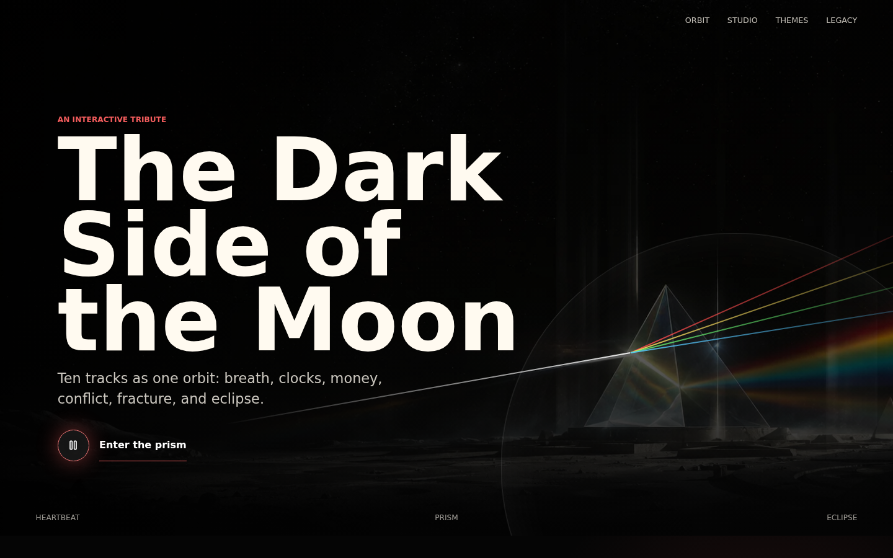
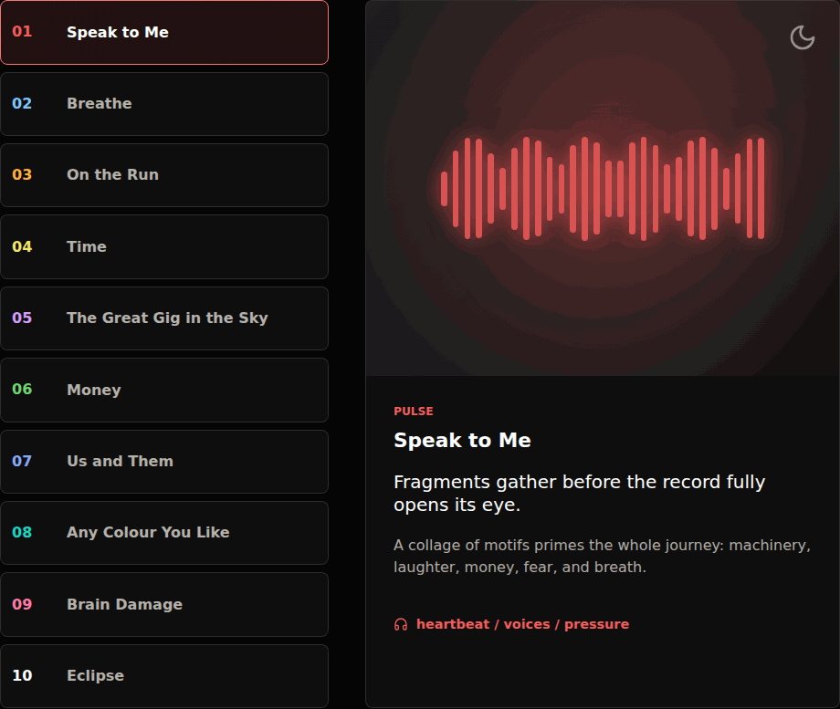
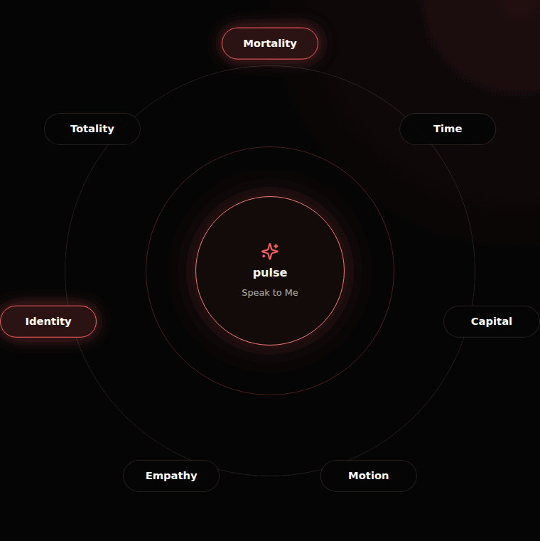
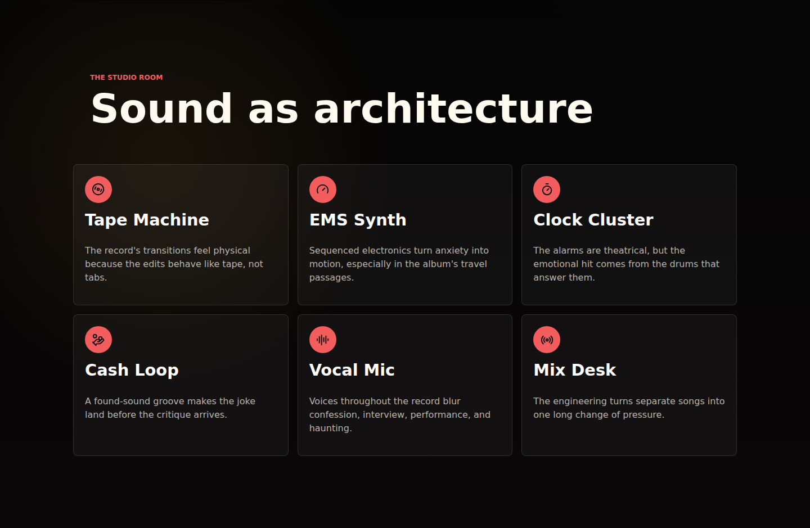
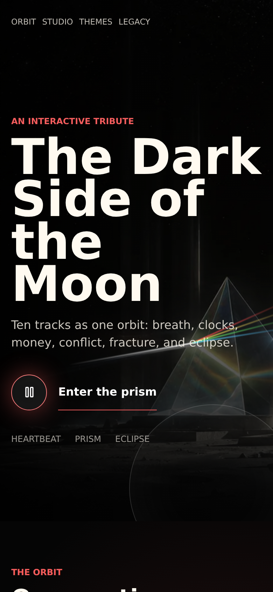
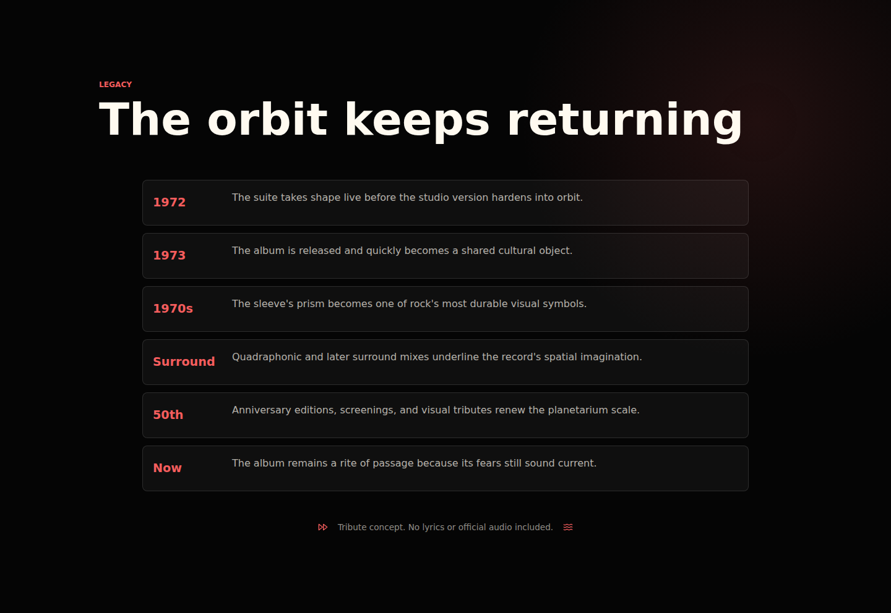

<p align="center">
  
</p>

<p align="center">
  <em>White light goes in. Everything you are comes out the other side.</em>
</p>

<p align="center">
  <a href="https://darkside-prism-tribute.netlify.app"></a>
  
  
  
  
</p>

---

# Enter The Prism

> *A heartbeat in the dark. A clock you didn't notice was ticking. A cash register that sounds suspiciously like a groove.*

**Enter The Prism** is an interactive tribute to Pink Floyd's *The Dark Side of the Moon*. It isn't a fan wiki or a playlist wrapper. It's a small **listening observatory** built around pulse, breath, time, money, fracture and eclipse.

The site treats the album as one continuous orbit. White light enters the prism as ordinary life, then splits into chambers of pressure, motion, grief, satire, empathy and totality.

<p align="center">
  <a href="https://darkside-prism-tribute.netlify.app">
    
  </a>
  <br />
  <sub><b>The Heartbeat.</b> A lone beam crosses the regolith, strikes the prism, and the record begins to breathe.</sub>
</p>

---

## ◐ The Orbit

> *Ten tracks. One long change of pressure. No gaps, because life doesn't leave any.*

Pick a track and the entire observatory re-tunes itself: accent colour, waveform, chamber glow, the studio icons, the constellation. Each chamber carries its own theme, signal path and interpretation. You can step through them with the mouse or the arrow keys, the way you'd move a stylus across the grooves.

<p align="center">
  
</p>

| | Track | Theme | Signal |
|:-:|---|---|---|
|  | **Speak to Me** | pulse | heartbeat / voices / pressure |
|  | **Breathe** | air | slide guitar / drifting organ |
|  | **On the Run** | flight | sequencer / airport anxiety |
|  | **Time** | age | clocks / toms / guitar solo |
|  | **The Great Gig in the Sky** | release | voice / piano / space |
|  | **Money** | greed | cash loop / bass / sax |
|  | **Us and Them** | distance | saxophone / choir / dynamics |
|  | **Any Colour You Like** | spectrum | synth / guitar / improvisation |
|  | **Brain Damage** | fracture | choir / acoustic guitar / rupture |
|  | **Eclipse** | totality | crescendo / heartbeat / closure |

---

## ✦ The Themes

> *Human scale, cosmic frame.*

Seven ideas hang in orbit around whatever you're listening to: **Mortality, Time, Capital, Motion, Empathy, Identity, Totality**. As you move through the record, the ones that track is pulling on light up in its colour.

<p align="center">
  
</p>

---

## ⧗ The Studio Room

> *Sound as architecture.* The tape machine, the EMS synth, the clock cluster, the cash loop, the vocal mic, the mix desk: six objects that turned separate songs into one weather system.

<p align="center">
  
</p>

---

## ☾ Everything Inside

| Chamber | What it does |
|---|---|
| 🫀 **The Heartbeat** | Cinematic lunar-prism hero. The CSS light beams are pinned to the prism in the artwork at every screen size. A play/pause control dims the ambient motion, and it starts paused if you've asked your OS for reduced motion. |
| 🌑 **The Orbit** | Ten interactive track chambers, each with its own colour, waveform, signal and interpretation. It's a fully keyboard-navigable tablist. |
| 🎛️ **The Studio Room** | Tactile production objects for tape, synth, clocks, cash loop, voice and mix architecture. |
| ✦ **The Themes** | A seven-node constellation that reacts to the track in your ears. |
| 👥 **The System** | Musicians, engineers, a singer and designers, framed as one atmosphere. |
| ⏳ **The Legacy** | A compact timeline of the album's continuing orbit, from 1972 to now. |

<table>
  <tr>
    <td width="34%" valign="top">
      
    </td>
    <td valign="top">
      <h3>Pocket-sized eclipse</h3>
      <p>The prism stays in frame on a phone: the hero art is anchored at the exact point where the beam strikes the glass. Track tabs collapse into a single column and the constellation tightens its orbit. Nothing spills off the edge of the moon.</p>
      <blockquote><em>Every light in the sky is a light that already left. The orbit keeps returning anyway.</em></blockquote>
      
    </td>
  </tr>
</table>

---

## ⏵ Run It Locally

```bash
npm install
npm run dev        # http://127.0.0.1:5173
```

Build and preview the production bundle:

```bash
npm run build      # type-check + Vite build → dist/
npm run preview
```

## ☁ Deployment

Production lives on Netlify at **[darkside-prism-tribute.netlify.app](https://darkside-prism-tribute.netlify.app)**.

```toml
[build]
  command = "npm run build"
  publish = "dist"
```

## ⚙ Stack

**Vite** · **React 19** · **TypeScript** · **Lucide icons** · **Netlify**. There's no audio engine and no canvas library. It's just CSS gradients, a little trigonometry and a lot of black.

```
src/main.tsx     every chamber of the observatory
src/styles.css   the light, the dark, and the orbit between
public/assets/   the lunar prism (WebP for the site, PNG for social cards)
docs/media/      the screenshots and GIFs you're looking at
PLAN.md          the original design brief
```

---

## ⚖ Rights And Respect

This is an **unofficial tribute concept**. It does not include official audio, band logos or full lyrics. The visual direction is inspired by prism optics and the album's themes. It does not recreate the original sleeve art.

The hero image is an original generated project asset (`public/assets/hero-lunar-prism.png`). The code is released under the [MIT License](./LICENSE).

<p align="center">
  <br />
  
  <br />
  <sub><em>The beam fades. The heartbeat doesn't.</em></sub>
</p>
